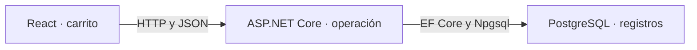

# KhypuPyme 2.0 · De la venta al registro

React prepara el carrito y envía la solicitud a la API de C#. La API comprueba quién opera, en qué negocio y si hay stock. PostgreSQL guarda la operación confirmada y los cambios de existencias y Caja.

## Sigue la venta en el código

| Paso | Archivo | Qué buscar |
|---|---|---|
| Revisar | [TradePage.tsx](../web/src/commerce/TradePage.tsx) | `useStockCheck` y la revisión del importe del carrito. |
| Enviar | [CommerceContext.tsx](../web/src/commerce/CommerceContext.tsx) | Envío a `/commands` y consulta de estado con el identificador original. |
| Recibir | [CommerceEndpoints.cs](../server/KhypuPyme.Api/Commerce/CommerceEndpoints.cs) | Rutas de disponibilidad, confirmación y consulta del documento. |
| Confirmar | [CommerceService.cs](../server/KhypuPyme.Api/Commerce/CommerceService.cs) | `ExecuteAsync` comprueba el contexto y confirma la transacción. |
| Registrar | [TradeOperations.cs](../server/KhypuPyme.Api/Commerce/TradeOperations.cs) | `SellAsync` prepara líneas, descuenta stock y aplica el cobro. |
| Inspeccionar | [CommerceModel.cs](../server/KhypuPyme.Api/Commerce/CommerceModel.cs) | `Entry` se guarda en `commerce_entries` y `EntryLine` en `commerce_lines`. |

Una consulta de disponibilidad ayuda a corregir el carrito. La confirmación vuelve a verificar el saldo dentro de la transacción. Si la respuesta se pierde, **Consultar estado** usa el identificador original para recuperar su resultado antes de ofrecer un reintento.

## Qué revisar en Sicomoro

1. Abre Caja con Bs 1.000 y compra diez tablas por Bs 500.
2. Vende dos tablas por Bs 200 en efectivo. Comprueba ocho piezas en Almacén, Bs 700 en Caja y el PDF de esa venta.
3. Pide nueve tablas de la misma medida. Comprueba que aparece un faltante de una pieza y que los saldos conservan lo registrado.

Los pasos de arranque y los datos completos están en el [README](../README.md#primer-parcial-de-práctica-interna). Los resultados de la comprobación están en [Verificación del primer parcial](PARCIAL1.md).
